  

  

# 💫 About me:
🔭 Estou trabalhando atualmente em Netbil Educacional (@netbileducacional). ☕️ Amante de café ❤️.  Três frases que podem mudar o seu dia:  🌠 "Se Deus te deu mais um dia de vida, é sinal que ele confia em você, não o decepcione." 💡 "Confiar em você é uma decisão minha, provar que eu estou errado, é uma escolha sua." 💎 "Um sábio disse, defenda-se com um sorriso, ofenda com o silêncio e vença com indiferença."

# 🌐 Social:
 

# 💻 Tech stack:
      	         

# 🚧 Development:

- [husky-commitlint-translate](https://github.com/MatheusNunesBoraso/husky-commitlint-translate.git)
